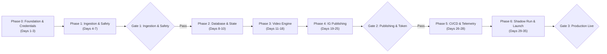
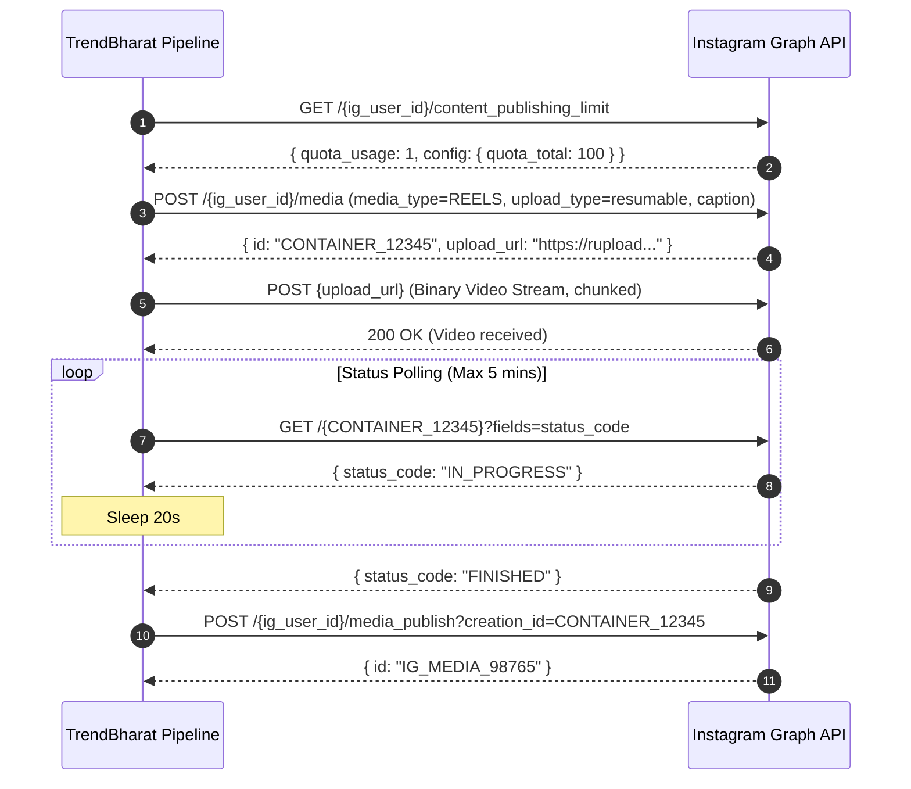

# TrendBharat: Implementation Roadmap & Execution Plan
**Automated Daily Instagram Reels Pipeline for India Search Trends**
*Document Version: 1.0.0 · Target Release: MVP (30-Day Autonomous Run)*
*Derived from: TrendBharat PRD & Technical Specification*

---

## 1. Executive Summary & Architecture Blueprint

TrendBharat is an autonomous, zero-cost, scheduled media publishing pipeline. Once per day at 7:00 PM IST, it ingests Google Trends data for India, sanitizes and categorizes the top 9 trending searches, renders an animated high-contrast 9:16 vertical countdown video (1080x1920 H.264/AAC) using Pillow and FFmpeg, uploads it via the official Meta Instagram Graph API (Reels), and reports run status to Telegram while committing run state to an SQLite database on a dedicated Git branch.

```
┌────────────────────────────────────────────────────────────────────────────────────────┐
│                                DAILY RUN PIPELINE (6:30 PM IST)                         │
└────────────────────────────────────────────────────────────────────────────────────────┘
 [External Cron] ──> [GitHub Actions: workflow_dispatch]
                           │
                           ▼
                  ┌───────────────────┐
                  │ 1. collector      │ <── Google Trends RSS (`geo=IN`)
                  │    - Fetch & parse│
                  │    - Clean/Safety │ <── Blocklist filter
                  │    - Categorize   │ <── Keyword classification
                  └─────────┬─────────┘
                            │ Top 9 Trends + Backups
                            ▼
                  ┌───────────────────┐
                  │ 2. db (SQLite)    │ <── Idempotent Run Record (`runs`, `trends`)
                  └─────────┬─────────┘
                            │
                            ▼
                  ┌───────────────────┐
                  │ 3. render         │
                  │    - Pillow Cards │ <── Noto Sans + Indic scripts font fallback
                  │    - FFmpeg MP4   │ <── 1080x1920 @ 30fps H.264 / AAC (~30s)
                  │    - ffprobe check│ <── Pre-flight aspect/codec/size check
                  └─────────┬─────────┘
                            │
                            ▼
                  ┌───────────────────┐
                  │ 4. publisher      │
                  │    - Container Req│ ──> Meta Graph API (`media_type=REELS`)
                  │    - Upload Video │ ──> Resumable Binary / URL Upload
                  │    - Poll Status  │ ──> Polling container `status_code`
                  │    - Publish Call │ ──> `media_publish`
                  └─────────┬─────────┘
                            │
                            ▼
                  ┌───────────────────┐
                  │ 5. telemetry & db │
                  │    - Telegram ping│ ──> Failure alert or daily success card
                  │    - Git Commit   │ ──> Push `trendbharat.db` to `data` branch
                  │    - Healthcheck  │ ──> External dead-man's switch
                  └───────────────────┘
```

### Core Architecture Guardrails
* **Zero Cost ($0/month):** GitHub Actions runner, free public Google Trends RSS feed, Pillow + FFmpeg open-source tools, Telegram Bot API, SQLite database on Git `data` branch.
* **Deterministic Reliability:** Run starts at 6:30 PM IST (30-min buffer ahead of 7:00 PM publication); external cron calls `workflow_dispatch` to bypass GitHub Actions scheduler jitter.
* **Idempotency & Safety:** Strict database constraint `run_date UNIQUE`; if a run already succeeded for today, subsequent triggers exit gracefully. All posts vetted against an explicit blocklist.
* **Visual Polish & Compliance:** Adheres strictly to Instagram Reels UI safe zones (margins: 80px left/right, 220px top, 380px bottom to avoid caption and UI button overlaps).

---

## 2. Project Breakdown & Phase Timeline Overview

The implementation is structured across **6 sequential phases over 5 weeks** (assuming 1–2 hours/day part-time effort), bounded by **3 formal Go/No-Go quality gates**.



| Phase | Focus Area | Deliverables | Est. Duration | Target Window |
|---|---|---|---|---|
| **Phase 0** | Setup, Accounts & Permissions | Repo scaffold, Meta App, Instagram Creator account, Telegram Bot | 3 days | Week 1 (Days 1–3) |
| **Phase 1** | Ingestion, Sanitization & Classification | Google RSS feed parser, blocklist, category tagger | 4 days | Week 1 (Days 4–7) |
| **GATE 1** | Ingestion & Content Safety Gate | 100% feed parsing accuracy, blocklist test coverage | Milestone | End of Week 1 |
| **Phase 2** | Database Layer & State Persistence | SQLite models, idempotent runner, Git `data` branch sync | 3 days | Week 2 (Days 8–10) |
| **Phase 3** | Typography, Pillow Cards & FFmpeg Video | 1080x1920 countdown slides, Indic fonts, FFmpeg compiler | 8 days | Weeks 2–3 (Days 11–18) |
| **Phase 4** | Instagram Graph API & Resumable Media | Meta container creation, video upload, polling, token refresh | 7 days | Weeks 3–4 (Days 19–25) |
| **GATE 2** | End-to-End Publishing Gate | Successful automated upload to private IG test account | Milestone | End of Week 4 |
| **Phase 5** | CI/CD, Orchestration & Alerts | GitHub Actions workflow, external cron trigger, Telegram alerts | 3 days | Week 4 (Days 26–28) |
| **Phase 6** | 7-Day Shadow Run & Production Go-Live | Live pilot runs, validation on physical phones, 30-day kickoff | 7 days | Week 5 (Days 29–35) |
| **GATE 3** | Production Launch Gate | 7 consecutive flawless runs, zero manual fixes | Milestone | Day 35 |

---

## 3. Detailed Phase-by-Phase Implementation Plan

### Phase 0: Project Setup, Accounts & Credentials Provisioning
**Duration:** Days 1–3 (Week 1) · **Owner:** Core Dev

#### Objectives
Establish the repository scaffold, Python development environment, and initiate long-lead platform access registrations (Meta Developer App, Instagram Creator account, Telegram Bot).

#### Tasks & Action Items
- [ ] **0.1 Initialize Project Repository Structure**
  Create directory layout according to Technical Specification:
  ```
  trendbharat/
  ├── collector/          # Ingestion, parsing, blocklist, classification
  ├── render/             # Pillow templates, Indic fonts, FFmpeg pipeline
  ├── publisher/          # Meta API client, token refresh, upload handler
  ├── scheduler/          # Daily orchestration entrypoint & CLI flags
  ├── db/                 # SQLite schema, migrations, connection manager
  ├── config/             # Blocklist keywords, category rules, app config
  ├── assets/             # Noto Sans fonts, background textures, audio
  ├── tests/              # Pytest unit & integration test suites
  ├── .github/workflows/  # CI/CD daily pipeline & token refresh workflows
  ├── requirements.txt    # Frozen dependencies
  └── README.md
  ```
- [ ] **0.2 Setup Python 3.12 Virtual Environment & Tooling**
  - Initialize virtual environment with Python 3.12.
  - Configure `requirements.txt` with pinned core dependencies: `requests>=2.31.0`, `feedparser>=6.0.10`, `Pillow>=10.3.0`, `pytest>=8.0.0`, `python-dotenv>=1.0.0`.
  - Configure code quality tooling: `ruff` for linting/formatting and `mypy` for static type checking.
- [ ] **0.3 Provision Meta Developer App & Instagram Professional Account**
  - Switch target Instagram account to **Professional (Creator or Business)**.
  - Create a new Meta App at [developers.facebook.com](https://developers.facebook.com) of type **Business**.
  - Add the **Instagram API with Instagram Login** product.
  - Configure requested permissions: `instagram_business_basic`, `instagram_business_content_publish`.
  - Add developer/tester roles for the Instagram account.
- [ ] **0.4 Build Token Exchange & Validation Script**
  - Write a one-time utility script `scripts/exchange_token.py` to exchange short-lived user tokens for a **60-day long-lived access token** via `GET https://graph.instagram.com/access_token`.
  - Verify retrieval of the Instagram User ID (`ig_user_id`).
- [ ] **0.5 Provision Telegram Alert Bot**
  - Create a new bot via `@BotFather` on Telegram (`@TrendBharatBot`).
  - Retrieve `TELEGRAM_BOT_TOKEN` and test recipient `TELEGRAM_CHAT_ID`.
  - Verify notification delivery using a quick cURL/requests test script.
- [ ] **0.6 Setup Local Secrets & GitHub Repository Secrets**
  - Setup local `.env.example` and `.env` (git-ignored).
  - Configure repository secrets on GitHub: `INSTAGRAM_ACCESS_TOKEN`, `INSTAGRAM_USER_ID`, `TELEGRAM_BOT_TOKEN`, `TELEGRAM_CHAT_ID`, `GH_PAT_DATA_BRANCH`.

#### Deliverables & Verification
* Passing sanity script connecting to Meta Graph API (`GET /me?fields=id,username`).
* Telegram test ping received on mobile device.
* Clean repository structure with passing `ruff check .`.

---

### Phase 1: Ingestion, Sanitization & Classification Engine
**Duration:** Days 4–7 (Week 1) · **Owner:** Backend / Data

#### Objectives
Construct a robust data collection pipeline that fetches the Google Trends India RSS feed, sanitizes titles, enforces the safety blocklist, categorizes queries, and selects the top 9 trends plus reserve backups.

#### Technical Specifications & Modules
* `collector/feed_reader.py`: Downloads `https://trends.google.com/trending/rss?geo=IN` with explicit timeouts and custom User-Agent headers.
* `collector/sanitizer.py`: Strips HTML artifacts, normalizes punctuation, cleans excessive whitespaces.
* `collector/safety_filter.py`: Validates queries against adult, crime, violence, political defamation, and tragic death keywords (`config/blocklist.json`).
* `collector/categorizer.py`: Rules-based classification engine (`Sports`, `Entertainment`, `Technology`, `Business & Finance`, `Jobs & Education`, `General`).

#### Tasks & Action Items
- [ ] **1.1 Implement RSS Ingestion with Retries**
  - Implement `fetch_india_trends(max_retries=3, backoff_factor=2)` using `requests.Session`.
  - Support fallback local XML fixture mode for testing without network dependency.
  - Parse `<item>` nodes extracting: `<title>`, `<ht:approx_traffic>`, `<description>`, `<pubDate>`.
- [ ] **1.2 Build Category Classifier Engine**
  - Create `config/categories.json` defining keyword dictionary:
    * *Sports:* cricket, ipl, bcci, match, score, vs, cup, tournament, football, messi, ronaldo, badminton.
    * *Entertainment:* movie, trailer, actor, actress, release date, review, song, teaser, ott, netflix.
    * *Technology:* ai, chatgpt, gemini, google, apple, iphone, update, launch, app, feature.
    * *Business:* share price, stock, sensex, nifty, gold rate, ipo, crypto, market.
  - Implement heuristic classifier returning matched category, normalized confidence, and category hashtag.
- [ ] **1.3 Implement Safety Blocklist & Filter Pipeline**
  - Create `config/blocklist.json` containing sensitive patterns:
    * Violent crime, assault, rape, homicide, suicide, communal slurs, sensitive political litigation, explicit adult content.
  - Filter logic: Flag item as `blocked=True`; discard from publishing pool and pull next-ranked candidate from the feed.
  - Implement strict fallback threshold: If fewer than 5 trends survive filtering, halt execution with an alert rather than publishing low-quality or padded content.
- [ ] **1.4 Unit Testing & Ingestion Benchmarking**
  - Write test suite `tests/test_collector.py` using recorded RSS responses.
  - Verify deterministic ordering (countdown order 9 down to 1).
  - Verify blocklist suppression on edge-case inputs.

#### Gate 1: Ingestion & Safety Quality Gate
> **Exit Criteria:**
> 1. Ingestion succeeds across 5 consecutive historical live feed samples.
> 2. 100% of synthetic unsafe trend titles in test suite are intercepted.
> 3. Classifier correctly maps at least 85% of real-world trending topics to relevant categories.

---

### Phase 2: Database Layer & State Management
**Duration:** Days 8–10 (Week 2) · **Owner:** Backend / DB

#### Objectives
Implement SQLite schema, migrations, connection wrappers, and the state persistence mechanism that syncs `trendbharat.db` to a dedicated `data` Git branch across stateless GitHub Actions runner invocations.

#### Database Schema Implementation (`db/schema.sql`)
```sql
CREATE TABLE IF NOT EXISTS runs (
  id INTEGER PRIMARY KEY AUTOINCREMENT,
  run_date TEXT NOT NULL UNIQUE,       -- Format: 'YYYY-MM-DD'
  status TEXT NOT NULL,                 -- started, collected, rendered, published, failed
  started_at TIMESTAMP DEFAULT CURRENT_TIMESTAMP,
  finished_at TIMESTAMP,
  error TEXT
);

CREATE TABLE IF NOT EXISTS trends (
  id INTEGER PRIMARY KEY AUTOINCREMENT,
  run_id INTEGER NOT NULL REFERENCES runs(id) ON DELETE CASCADE,
  rank INTEGER NOT NULL,
  query TEXT NOT NULL,
  category TEXT,
  approx_volume INTEGER,
  blocked BOOLEAN DEFAULT 0,
  selected BOOLEAN DEFAULT 0,
  raw_payload TEXT
);

CREATE TABLE IF NOT EXISTS posts (
  id INTEGER PRIMARY KEY AUTOINCREMENT,
  run_id INTEGER NOT NULL UNIQUE REFERENCES runs(id) ON DELETE CASCADE,
  caption TEXT,
  status TEXT NOT NULL,                 -- pending, uploaded, processing, published, failed
  container_id TEXT,
  ig_media_id TEXT,
  video_bytes INTEGER,
  attempts INTEGER DEFAULT 0,
  published_at TIMESTAMP,
  error TEXT
);

CREATE TABLE IF NOT EXISTS slides (
  id INTEGER PRIMARY KEY AUTOINCREMENT,
  post_id INTEGER NOT NULL REFERENCES posts(id) ON DELETE CASCADE,
  position INTEGER NOT NULL,            -- 0: Cover, 1-9: Trend Cards
  trend_id INTEGER REFERENCES trends(id),
  image_path TEXT NOT NULL
);
```

#### Tasks & Action Items
- [ ] **2.1 Implement Database Manager (`db/manager.py`)**
  - Write context-managed SQLite connection handling foreign keys and WAL mode.
  - Implement transactional methods: `create_or_resume_run(run_date)`, `record_trends(...)`, `update_run_status(...)`, `record_post(...)`.
  - Enforce idempotency: If `run_date` exists with `status == 'published'`, abort with log `"Run for today already completed. Exiting."`.
- [ ] **2.2 Implement Git `data` Branch Synchronization**
  - Write bash/Python script `scripts/sync_data_branch.sh` (or Python helper):
    * Step A (Run start): Checkout or fetch `trendbharat.db` from `data` branch. If none exists, run initial migrations.
    * Step B (Run end): Stage `trendbharat.db`, commit with message `chore(data): auto-update state for YYYY-MM-DD [skip ci]`, and push back to `data` branch via GitHub Actions token.
- [ ] **2.3 Test Database Operations & Recovery Scenarios**
  - Test simulated crash mid-run and verify safe resume behavior.
  - Verify that cascading foreign key constraints prevent orphan records.

---

### Phase 3: Visual Typography & Video Rendering Engine
**Duration:** Days 11–18 (Weeks 2–3) · **Owner:** Creative / Graphics / Video

#### Objectives
Design and build high-contrast 1080x1920 (9:16) vertical cards using Pillow, render multi-lingual Indic typography without square glyph artifacts, compile cards into an H.264/AAC MP4 video with FFmpeg, and validate compliance via `ffprobe`.

#### Visual Layout & Safe Zone Specifications
* **Canvas Size:** 1080 × 1920 px (9:16 Aspect Ratio).
* **Instagram Safe Zone Insets:**
  * Top Margin: 240 px (clears Instagram header & account details).
  * Bottom Margin: 420 px (clears Reel caption, sound attribution, bottom navigation bar).
  * Right Margin: 140 px (clears like, comment, share, audio disc action icons).
  * Left Margin: 80 px.
* **Palette:** Dark Slate / Deep Navy background (`#0B0F19`), Crisp White primary text (`#FFFFFF`), Vibrant Accent for ranks & categories (Electric Amber `#F59E0B` or Cyber Cyan `#06B6D4`), Subtle secondary text (`#94A3B8`).

#### Tasks & Action Items
- [ ] **3.1 Typography & Asset Pipeline Setup**
  - Download and bundle official Google Noto Sans font families under `assets/fonts/`:
    * `NotoSans-Bold.ttf`, `NotoSans-Medium.ttf`
    * `NotoSansDevanagari-Bold.ttf` (Hindi, Marathi)
    * `NotoSansTamil-Bold.ttf`, `NotoSansBengali-Bold.ttf`, `NotoSansTelugu-Bold.ttf`.
  - Implement unicode script detector in `render/font_resolver.py` that selects the appropriate font family based on characters present in the trend query.
- [ ] **3.2 Implement Card Generator (`render/card_builder.py`)**
  - Build `render_cover_card(date_str, total_trends)`:
    * Hook header: "WHAT INDIA SEARCHED TODAY".
    * Calendar date and dynamic subtitle: "Top 9 Daily Countdown".
    * Footer: Handle `@TrendBharat` + "Source: Google Trends".
  - Build `render_trend_card(rank, query, category, approx_volume, date_str)`:
    * Giant countdown badge: `#09` down to `#01`.
    * Category badge pill: `SPORTS`, `TECH`, etc.
    * Dynamic text wrapper with auto-scaling font size: Start at 68pt, shrink down to 42pt if text exceeds 2 lines; truncate with ellipsis if still overflowing.
    * Search volume badge (e.g. `100K+ searches`).
- [ ] **3.3 Implement Caption Builder (`render/caption_builder.py`)**
  - Generate caption strictly formatted to place the hook within the initial 125 characters (before Instagram folds text behind "...more"):
    ```text
    What is India searching today? Top 9 countdown for {formatted_date}! 🇮🇳👇

    Here are today's highest trending searches across India:
    {numbered_trend_list}

    Follow @{handle} for your daily 30-second India trend pulse.
    Source: Google Trends.

    #TrendBharat #IndiaTrends #TrendingNow #{category_hashtags}
    ```
- [ ] **3.4 Implement FFmpeg Video Compiler (`render/video_compiler.py`)**
  - Construct FFmpeg command generating smooth visual transitions:
    * 1 Cover Card (2.5 seconds).
    * 9 Countdown Cards (3.0 seconds each, from rank 9 down to 1).
    * Total Duration: ~29.5 seconds.
    * Video Codec: `libx264`, Pixel Format: `yuv420p`, Profile: `high`, Preset: `fast`, Framerate: `30 fps`.
    * Audio: Silent AAC audio stream (`anullsrc=channel_layout=stereo:sample_rate=44100`) or bundled royalty-free low-beat soundtrack (checked against YouTube Audio Library).
- [ ] **3.5 Implement Pre-Flight Probe Validator (`render/validator.py`)**
  - Run `ffprobe -v error -show_entries ...` inspecting output file:
    * Assert dimensions == `1080x1920`.
    * Assert aspect ratio == `9:16`.
    * Assert duration between 25 and 35 seconds.
    * Assert container size < `50 MB` (well under Instagram 100MB threshold).
    * Assert valid audio stream present (Instagram rejects Reels without an audio track).

#### Deliverables & Verification
* Automated test rendering synthetic Hindi, Tamil, and English cards into PNGs.
* Compiled 30-second test MP4 inspected on VLC and mobile display to verify safe-zone alignment.

---

### Phase 4: Instagram Graph API & Resumable Media Publishing
**Duration:** Days 19–25 (Weeks 3–4) · **Owner:** Integration / Meta Platform

#### Objectives
Integrate Meta's official Content Publishing API for Instagram Reels using Instagram Login with Business/Creator accounts. Handle container initialization, resumable binary video uploads, status polling with backoff, final publication, and 60-day token automated refresh.



#### Tasks & Action Items
- [ ] **4.1 Implement Meta API Client (`publisher/instagram_client.py`)**
  - Wrap Graph API v21.0 endpoints with structured logging and retry logic.
  - Implement `check_publishing_quota()` querying `content_publishing_limit`.
- [ ] **4.2 Implement Resumable Reel Container & Video Uploader**
  - Step 1: Initiate container via `POST /{ig_user_id}/media`:
    * Parameters: `media_type=REELS`, `upload_type=resumable`, `caption={caption}`.
    * Receive `id` (container ID) and `upload_url`.
  - Step 2: Upload raw MP4 bytes to `upload_url` with headers `Authorization: OAuth {token}`, `Offset: 0`, `Content-Type: application/octet-stream`.
- [ ] **4.3 Implement Container Status Polling Loop**
  - Poll `GET /{container_id}?fields=status_code` every 15–20 seconds.
  - Possible statuses:
    * `IN_PROGRESS`: Continue polling (max 15 attempts / 5 minutes).
    * `FINISHED`: Break and proceed to publish.
    * `ERROR`: Extract failure reason, raise `InstagramProcessingException`, trigger Telegram alert.
    * `EXPIRED`: Container died; trigger clean retry.
- [ ] **4.4 Trigger Publication & Record Metadata**
  - Invoke `POST /{ig_user_id}/media_publish?creation_id={container_id}`.
  - Capture returned `id` (public Instagram Media ID).
  - Update `posts` record in SQLite (`status='published'`, `ig_media_id`, `published_at`).
- [ ] **4.5 Implement Automated Token Refresher (`publisher/token_manager.py`)**
  - Implement token age tracker: Read last refresh timestamp.
  - Meta tokens can be refreshed once they are >24 hours old and remain valid for 60 days.
  - Call `GET https://graph.instagram.com/refresh_access_token?grant_type=ig_refresh_token&access_token={token}` every 30 days.
  - For local runs: Write updated token to `.env`. For GitHub Actions: Dispatch a notification or use GitHub Secrets API with a repository-scoped PAT to update `INSTAGRAM_ACCESS_TOKEN`.

#### Gate 2: End-to-End Publishing Gate
> **Exit Criteria:**
> 1. Complete end-to-end execution of Phase 1 through Phase 4 in a staging/sandbox Instagram account.
> 2. Reel appears on Instagram with correct 9:16 aspect ratio, readable fonts, and correct audio playback.
> 3. SQLite database records container ID, media ID, and timestamp correctly.

---

### Phase 5: CI/CD Orchestration, Telemetry & Reliability
**Duration:** Days 26–28 (Week 4) · **Owner:** DevOps / Reliability

#### Objectives
Package the end-to-end pipeline into an executable CLI, configure the GitHub Actions workflow runner, wire an external cron service via `workflow_dispatch` to guarantee timely execution, implement Telegram alerts, and set up a heartbeat monitor.

#### Tasks & Action Items
- [ ] **5.1 Build Main Orchestrator CLI (`scheduler/daily_runner.py`)**
  - Provide command-line flags:
    * `--dry-run`: Runs ingestion, database recording, card rendering, and video compilation; skips Meta upload.
    * `--post-now`: Runs immediate production pipeline.
    * `--force-date YYYY-MM-DD`: Overrides current system date for backfill testing.
  - Wrap pipeline execution in a top-level try/except handler with clean exit codes (`0` = success, `1` = transient error, `2` = unrecoverable).
- [ ] **5.2 Implement Telegram Telemetry (`alerts/telegram_notifier.py`)**
  - Success Message: Sends run duration, trend count, categories breakdown, and a link to the published Reel (`https://www.instagram.com/reel/{media_id}`).
  - Failure Alert: Sends alert with failed stage (`collector`, `render`, `publisher`), error message, truncated stack trace, and run log excerpt.
- [ ] **5.3 Configure GitHub Actions Workflow (`.github/workflows/daily_pipeline.yml`)**
  - Runner: `ubuntu-latest`.
  - Dependencies: Install system `ffmpeg` via `sudo apt-get update && sudo apt-get install -y ffmpeg`.
  - Execution steps:
    1. Checkout repository with `fetch-depth: 0`.
    2. Setup Python 3.12 with caching.
    3. Install Python dependencies from `requirements.txt`.
    4. Fetch latest `trendbharat.db` from `data` branch.
    5. Run `python -m scheduler.daily_runner --post-now`.
    6. Commit and push updated `trendbharat.db` back to `data` branch.
    7. Send heartbeat ping to Healthchecks.io.
- [ ] **5.4 Configure Precision External Trigger & Heartbeat**
  - Setup a free cron service (e.g., [cron-job.org](https://cron-job.org)) scheduled at **13:00 UTC (6:30 PM IST)** daily.
  - Configure POST request to GitHub API:
    `POST https://api.github.com/repos/{owner}/{repo}/actions/workflows/daily_pipeline.yml/dispatches` with header `Authorization: Bearer {GH_PAT}` and body `{"ref": "main"}`.
  - Setup free monitor on [Healthchecks.io](https://healthchecks.io); expect ping daily by 7:15 PM IST. If no ping is received, sends email/SMS/Telegram alert for silent failures.

---

### Phase 6: Staging Simulation, 7-Day Shadow Run & Production Launch
**Duration:** Days 29–35 (Week 5) · **Owner:** Core Team

#### Objectives
Execute a 7-day automated dry-run / shadow run in production environment. Validate that the pipeline runs every day without manual intervention, verifies video visual quality on mobile devices, tests recovery logic, and performs the official Day 1 live post.

#### Tasks & Action Items
- [ ] **6.1 Execute 7-Day Shadow Run (Dry-Run Mode)**
  - Days 29–33: Let external cron trigger GitHub Actions in `--dry-run` mode daily at 6:30 PM IST.
  - Store rendered MP4 artifacts in GitHub Actions run artifacts.
  - Download and review MP4s on physical smartphones (iOS and Android).
  - Verify Indic font glyph rendering across diverse regional trends (Hindi, Tamil, Marathi names).
- [ ] **6.2 Conduct Failure Mode Simulation Testing**
  - Simulate Google RSS network timeout -> verify retry logic and alert.
  - Simulate dirty trend strings (special characters, emoji, HTML entities) -> verify sanitizer.
  - Simulate blocked keyword input -> verify candidate rejection and replacement with rank #10.
- [ ] **6.3 Final Go/No-Go Production Gate Review**
  - Review Gate 3 checklist (see Section 4).
  - Switch orchestrator flag from `--dry-run` to live publishing.
- [ ] **6.4 Day 1 Production Post Execution (Day 35)**
  - 6:30 PM IST: Pipeline initiates.
  - 6:48 PM IST: Video rendered and verified.
  - 7:00 PM IST: Reel published to live Instagram account.
  - 7:05 PM IST: Live verification of video, caption, audio, and hashtags on Instagram app.

---

## 4. Quality Gates & Decision Checkpoints

```
GATE 1: Week 1 End (Ingestion & Safety)
  │
  ├─► [PASS]: RSS parsing 100% reliable; blocklist suppresses toxic queries -> Proceed to Phase 2
  └─► [FAIL]: RSS feed unstable or blocked -> Pivot to RSS alternative or open-source wrapper (trendspyg)

GATE 2: Week 4 End (Media Publishing & Token)
  │
  ├─► [PASS]: Container created, MP4 uploaded, status polling succeeds, Reel visible -> Proceed to Phase 5
  └─► [FAIL]: Meta rejects upload/codec -> Re-encode FFmpeg parameters; check Instagram permissions

GATE 3: Week 5 End (Production Go-Live)
  │
  ├─► [PASS]: 7 consecutive automated shadow runs, 0 manual fixes, mobile video check -> GO LIVE
  └─► [FAIL]: Pipeline jitter or timing failures -> Extend shadow run by 3 days; fix cron trigger
```

### Detailed Gate Criteria

#### Gate 1: Ingestion & Safety (End of Week 1)
- [ ] Ingestion succeeds against Google Trends India RSS feed across 7 consecutive test runs.
- [ ] Ingestion module handles missing traffic numbers gracefully.
- [ ] Blocklist intercepts 100% of synthetic unsafe test queries (violence, hate, adult, defamation).
- [ ] Fallback pool supplies replacement trends so top 9 count is maintained.

#### Gate 2: Media Publishing & Token (End of Week 4)
- [ ] Meta API container creation succeeds with `media_type=REELS`.
- [ ] Resumable upload completes without network dropouts.
- [ ] Polling detects `FINISHED` state within 2 minutes.
- [ ] Rendered video complies with all Instagram limits: 1080x1920, H.264, AAC audio, <50MB.
- [ ] Published Reel displays properly in Instagram app without UI overlay collisions.

#### Gate 3: Production Go-Live (Day 35)
- [ ] 7 consecutive automated runs executed on GitHub Actions via external cron trigger.
- [ ] Mean time from trigger to publish is under 12 minutes (well within 30-min window).
- [ ] Zero manual human interventions required during the 7-day shadow window.
- [ ] Telegram notifications accurately delivered daily.
- [ ] Token refresh logic tested and documented.

---

## 5. Traceability Matrix: PRD & Technical Spec to Implementation

| PRD / Spec Requirement | Architecture / Module | Implementation Phase | Test / Verification Method |
|---|---|---|---|
| Ingest top 10 trends for India (`geo=IN`) | `collector/feed_reader.py` | Phase 1 | Pytest with live & mocked RSS feeds |
| Filter adult, violence, crime, hate | `collector/safety_filter.py` | Phase 1 | Synthetic test suite with 50+ toxic terms |
| Categorize by niche (Sports, Tech, etc.) | `collector/categorizer.py` | Phase 1 | Keyword matching benchmark test |
| Single run per day idempotency | `db/manager.py` | Phase 2 | Unique constraint test on `run_date` |
| Store run state across stateless runners | `scripts/sync_data_branch.sh` | Phase 2 | CI test committing to git `data` branch |
| 1080x1920 9:16 high contrast cards | `render/card_builder.py` | Phase 3 | Visual regression test & safe-zone mask |
| Indic fonts support (Hindi, Tamil, etc.) | `render/font_resolver.py` | Phase 3 | Glyph rendering test on Unicode strings |
| 30-second H.264/AAC countdown video | `render/video_compiler.py` | Phase 3 | `ffprobe` format & duration validation |
| Hook in first 125 chars of caption | `render/caption_builder.py` | Phase 3 | Assertion test on length before fold |
| Resumable Reel upload to Meta API | `publisher/instagram_client.py`| Phase 4 | Integration test on staging IG account |
| 60-day token automated refresh | `publisher/token_manager.py` | Phase 4 | Refresh endpoint response validation |
| Fixed 7:00 PM IST posting (6:30 trigger) | `.github/workflows/daily.yml` | Phase 5 | External cron dispatch verification |
| Telegram alerts on success/failure | `alerts/telegram_notifier.py` | Phase 5 | Telegram Bot API message delivery |
| $0/month total infrastructure cost | Whole Stack | Phases 0–5 | Zero paid service audit |

---

## 6. Risk Management, Failure Modes & Runbooks

| Failure Scenario | Severity | Probability | Detection Mechanism | Automated Mitigation | Manual Runbook |
|---|---|---|---|---|---|
| **Google Trends RSS 429/Down** | High | Medium | HTTP error in `collector` | Retry 3x with backoff; abort if still empty | Alert sent to Telegram. Check if feed URL changed; run backfill with `--force-date` when restored. |
| **Fewer than 9 trends survive filter** | Medium | Low | Count check in `collector` | Pull from reserve trends; if still <9, render shorter video | Review `config/blocklist.json` to verify no false positives. |
| **Meta Video Processing Error** | High | Low | Polling status == `ERROR` | Re-render with conservative FFmpeg profile and retry once | Inspect downloaded MP4 with `ffprobe`. Verify container codec compliance. |
| **Meta Access Token Expired** | Critical| Low | API 401 / `OAuthException` | Pre-expiry refresh job at 30 days | Run `python scripts/exchange_token.py` locally and update GitHub Secret. |
| **External Cron Fails to Trigger** | High | Medium | Healthchecks.io dead-man ping missing | Fallback GitHub native schedule trigger (`cron: '0 13 * * *'`) | Manually trigger via GitHub UI (`workflow_dispatch`). |
| **GitHub Actions Runner Queued Late** | Medium | Medium | Runner queue latency check | 30-minute buffer window (6:30 start for 7:00 post) | If post publishes after 7:15 PM, investigate GitHub status page. |
| **Inappropriate Trend Published** | Critical| Low | Follower report / log inspection | Blocklist + prompt post-publish link | Execute `python -m publisher.delete_post --media-id {ID}` or delete directly in IG app. |

### Emergency Post-Deletion Runbook
If an unsafe topic slips through into a live post:
1. Open Instagram App on mobile -> Navigate to profile -> Tap Reel -> `...` Menu -> **Delete**.
2. Alternatively, run emergency script:
   ```bash
   python -m publisher.emergency_delete --ig-media-id <MEDIA_ID>
   ```
3. Add the triggering phrase immediately to `config/blocklist.json` and push to `main`.

---

## 7. Post-MVP Evolution Roadmap (v1.1 & v2.0)

Once the core MVP completes its 30-day autonomous run, the following features are scheduled for rollout:

```
MVP (Current)           v1.1 (Enhancement)            v2.0 (Scale & Intelligence)
┌─────────────────┐     ┌───────────────────────┐     ┌────────────────────────┐
│ • Daily Reel    │     │ • Carousel Generator  │     │ • Regional Captions    │
│ • Zero Cost     │ ──> │ • Telegram Approval   │ ──> │ • AI Context Summaries │
│ • Top 9 Trends  │     │ • Audio Library Sync  │     │ • Automated Analytics  │
│ • English Post  │     │ • Dynamic Color Themes│     │ • Multi-Account Support│
└─────────────────┘     └───────────────────────┘     └────────────────────────┘
```

### Version 1.1 Enhancements
* **Dual-Format Carousel Auto-Generator:** Generate a 10-slide saveable carousel (1080x1350 4:5 format) from the same ingested trend data to capture bookmark/save engagement alongside Reel reach.
* **Telegram Interactive Approval Switch:** Introduce an optional Telegram bot prompt at 6:45 PM IST with inline buttons `[Approve & Post]` / `[Regenerate]` / `[Cancel]`. If unapproved after 14 minutes, fall back to default auto-post setting.
* **Dynamic Visual Themes:** Switch card palette based on the dominant daily category (e.g., Emerald Green for Cricket match days, Royal Purple for Entertainment awards, Tech Blue for AI updates).

### Version 2.0 Strategic Expansions
* **LLM-Powered Trend Explainer:** Integrate Gemini API (free tier) to generate a punchy 1-sentence explanation of *why* each query spiked (e.g., "Kantara: Teaser 2 released today").
* **Multi-Lingual Captions:** Publish bilingual captions (English + Hindi Devanagari script) to boost local search discovery.
* **Automated Analytics & Best-Hour Optimizer:** Pull daily engagement metrics (plays, reach, saves, shares) via Instagram Graph Insights API and dynamically adjust publication timing.

---

## 8. Definition of Done & Success Criteria Checklist

### Milestone Definition of Done (DoD)
A phase is considered complete only when:
1. **Code:** Written, strictly typed with type hints, and passes `ruff check .` with zero errors.
2. **Tests:** All unit and integration tests pass via `pytest tests/`.
3. **Docs:** Inline docstrings written for all public functions and classes.
4. **Idempotency:** Re-running the module with identical parameters does not corrupt state or trigger duplicate actions.
5. **Secrets:** No access tokens, webhook URLs, or sensitive identifiers committed to version control.

### 30-Day Operational SLA Targets
* **Publication Uptime:** $\ge 30 / 30$ scheduled days posted successfully.
* **On-Time Delivery:** Reel goes live between 6:55 PM and 7:05 PM IST daily.
* **Trend Count Integrity:** Every Reel contains 9 valid trend cards + 1 cover card.
* **Zero Cost Verified:** \$0.00 incurred across all platform and compute providers.
* **Zero Manual Interventions:** The pipeline self-heals across transient network hiccups.

